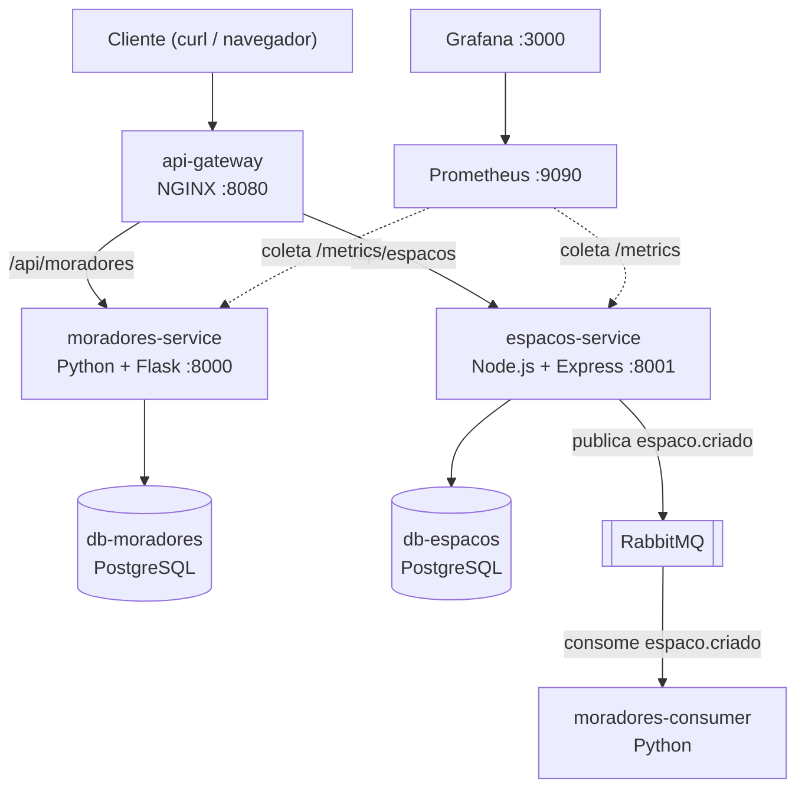

# Condiminous

Aplicação distribuída para administração de condomínios, construída com **arquitetura de microsserviços**. O sistema gerencia **moradores** e **espaços comuns** (salão de festas, churrasqueira, piscina...) por meio de dois serviços independentes, cada um com linguagem e banco de dados próprios. Tudo roda em contêineres Docker, orquestrados pelo Docker Compose.

Trabalho prático da disciplina de Computação Distribuída (UFMS, Câmpus de Três Lagoas, Bacharelado em Sistemas de Informação).

**Integrantes:** Marcelly Lais Ferreira de Almeida e Nicoly Machado Calixto

---

## Sumário

1. [Arquitetura](#arquitetura)
2. [Tecnologias e justificativas](#tecnologias-e-justificativas)
3. [Pré-requisitos](#pré-requisitos)
4. [Como executar](#como-executar)
5. [Endpoints](#endpoints)
6. [Validação passo a passo](#validação-passo-a-passo)
7. [Observabilidade](#observabilidade)
8. [Mensageria](#mensageria)
9. [Estrutura do repositório](#estrutura-do-repositório)
10. [Solução de problemas](#solução-de-problemas)

---

## Arquitetura



| Componente | Tecnologia | Responsabilidade |
|---|---|---|
| `api-gateway` | NGINX | Ponto único de entrada e roteamento das APIs |
| `moradores-service` | Python 3.12 + Flask | CRUD de moradores |
| `moradores-consumer` | Python + Pika | Consumo assíncrono dos eventos de espaços |
| `db-moradores` | PostgreSQL 16 | Persistência exclusiva de moradores |
| `espacos-service` | Node.js 20 + Express | CRUD de espaços comuns e publicação de eventos |
| `db-espacos` | PostgreSQL 16 | Persistência exclusiva de espaços |
| `rabbitmq` | RabbitMQ 3.13 | Comunicação assíncrona entre os serviços |
| `prometheus` | Prometheus | Coleta das métricas dos serviços |
| `grafana` | Grafana | Visualização das métricas em dashboard |

Todos os contêineres participam da rede Docker `condiminous-net`. **As APIs são acessadas apenas pelo gateway**: os serviços e os bancos não publicam portas no computador hospedeiro.

---

## Tecnologias e justificativas

**Divisão em dois microsserviços.** Moradores e espaços comuns são contextos de negócio independentes (*bounded contexts*): cada um tem dados, regras e motivos de mudança próprios. Separá-los permite evoluir, implantar e escalar cada parte sem afetar a outra.

**Linguagens diferentes (Python e Node.js).** Demonstram a independência tecnológica dos microsserviços. Como os serviços só se comunicam por HTTP/JSON e por mensagens, a linguagem de um não interfere no outro.
- **Flask** é um microframework: oferece apenas o necessário para uma API REST pequena, sem a estrutura pesada de frameworks como o Django.
- **Express** é o framework web mais difundido do Node.js. O modelo assíncrono do Node é adequado para APIs que passam a maior parte do tempo aguardando o banco de dados.

**Um banco por serviço (*database per service*).** Cada serviço acessa somente a sua própria instância PostgreSQL. Um banco compartilhado acoplaria os serviços pelo esquema das tabelas, e uma falha nele derrubaria os dois. Um serviço só obtém dados do outro pela API ou por eventos.

**PostgreSQL.** Os dois modelos são estruturados e possuem regras de integridade (campos obrigatórios, capacidade maior que zero, taxa não negativa), o que favorece um banco relacional com restrições (*constraints*). O isolamento vem de serem **instâncias separadas**, com volumes separados.

**NGINX como API Gateway.** Oferece um ponto único de entrada (`localhost:8080`), esconde a topologia interna e as portas dos serviços e remove o prefixo `/api` antes de encaminhar a requisição. É leve, estável e configurado em um único arquivo.

**RabbitMQ.** Permite comunicação assíncrona e desacoplada: o produtor publica o evento sem saber quem o consome nem aguardar resposta. Se o consumidor estiver fora do ar, a mensagem permanece na fila. Para o volume deste projeto, o RabbitMQ é mais simples e adequado que o Kafka, voltado a *streaming* de altíssimo volume.

**Prometheus e Grafana.** Em um sistema distribuído não é possível diagnosticar problemas olhando um único processo. O Prometheus coleta periodicamente (modelo *pull*) as métricas expostas por cada serviço, e o Grafana as apresenta em um dashboard. Ambos são provisionados automaticamente por arquivos, então o ambiente funciona em uma máquina limpa sem configuração manual.

**Docker e Docker Compose.** Garantem que o ambiente seja idêntico em qualquer máquina e sobem todos os componentes com um único comando. O Compose cria a rede interna (os serviços se encontram pelo nome do contêiner), os volumes persistentes e a ordem de inicialização por *healthchecks*.

---

## Pré-requisitos

- [Git](https://git-scm.com/)
- [Docker](https://docs.docker.com/get-docker/) com Docker Compose v2 (no Windows e no macOS, o **Docker Desktop** deve estar aberto)
- Portas livres no computador: `8080`, `9090`, `3000` e `15672`

Não é necessário instalar Python, Node.js nem PostgreSQL: tudo roda dentro dos contêineres.

---

## Como executar

```bash
git clone https://github.com/marcellylais/condiminous.git
cd condiminous
```

Crie o arquivo de variáveis de ambiente a partir do modelo:

```bash
# Linux / macOS / Git Bash
cp .env.example .env
```
```cmd
:: Windows (cmd)
copy .env.example .env
```

Suba todo o ambiente:

```bash
docker compose up --build -d
```

Acompanhe até todos os contêineres aparecerem como `running` e, quando houver healthcheck, `healthy` (pode levar cerca de 30 segundos na primeira execução):

```bash
docker compose ps
```
Contêineres esperados: `db-moradores`, `db-espacos`, `moradores-service`, `moradores-consumer`, `rabbitmq`, `espacos-service`, `api-gateway`, `prometheus` e `grafana`.

### Endereços

| O quê | Endereço |
|---|---|
| API (via gateway) | http://localhost:8080/api/... |
| Prometheus | http://localhost:9090 |
| Grafana | http://localhost:3000 (abre o dashboard sem login; admin: `admin` / `admin`) |
| RabbitMQ Management | http://localhost:15672 (usuário e senha do `.env`) |

### Parar o ambiente

```bash
docker compose down        # para e remove os contêineres, mantendo os dados
docker compose down -v     # também apaga os volumes (bancos voltam aos dados iniciais)
```

---

## Endpoints

Todas as rotas públicas passam pelo gateway em `http://localhost:8080`. O NGINX remove o prefixo `/api` antes de encaminhar (por exemplo, `/api/moradores` chega ao Flask como `/moradores`).

### Moradores

| Método | Rota | Descrição | Sucesso |
|---|---|---|---|
| `GET` | `/api/moradores` | Lista todos os moradores | 200 |
| `GET` | `/api/moradores/:id` | Busca um morador | 200 |
| `POST` | `/api/moradores` | Cadastra um morador | 201 |
| `PUT` | `/api/moradores/:id` | Atualiza um morador | 200 |
| `DELETE` | `/api/moradores/:id` | Remove um morador | 200 |

```json
{ "nome": "Ana Souza", "bloco": "A", "apto": "102" }
```
Regras: `nome`, `bloco` e `apto` são obrigatórios e não podem ser vazios. O `id` é gerado pelo banco; se o cliente enviar um, ele é ignorado.

### Espaços comuns

| Método | Rota | Descrição | Sucesso |
|---|---|---|---|
| `GET` | `/api/espacos` | Lista todos os espaços | 200 |
| `GET` | `/api/espacos/:id` | Busca um espaço | 200 |
| `POST` | `/api/espacos` | Cadastra um espaço | 201 |
| `PUT` | `/api/espacos/:id` | Atualiza um espaço | 200 |
| `DELETE` | `/api/espacos/:id` | Remove um espaço | 200 |

```json
{ "nome": "Salão de Festas", "capacidade": 80, "taxa": 150.0 }
```
Regras: `nome` e `capacidade` são obrigatórios; `capacidade` deve ser um inteiro maior que zero; `taxa` é opcional (padrão `0`) e não pode ser negativa. O `id` é gerado pelo banco.

### Rotas técnicas

| Rota no gateway | Descrição |
|---|---|
| `/gateway/health` | Saúde do próprio NGINX |
| `/health/moradores` · `/health/espacos` | Saúde do serviço e da conexão com o seu banco |
| `/metrics/moradores` · `/metrics/espacos` | Métricas no formato do Prometheus |

Resposta saudável do `/health`:
```json
{ "status": "ok", "service": "moradores-service", "database": "connected" }
```
Se o banco estiver inacessível, a resposta é `503` com `"status": "error"`.

### Códigos HTTP e formato de erro

Os dois serviços usam o mesmo formato de erro:
```json
{ "erro": "Morador não encontrado" }
```

| Código | Uso |
|---|---|
| 200 | Consulta, atualização ou exclusão |
| 201 | Criação |
| 400 | JSON ausente ou dados inválidos |
| 404 | Registro ou rota inexistente |
| 500 | Erro interno inesperado (sem expor detalhes internos) |
| 503 | Banco de dados indisponível |

---

## Validação passo a passo

Os exemplos usam `curl`. No **Windows (cmd)**, as aspas internas do JSON precisam ser escapadas com `\"`; as duas formas estão indicadas.

### 1. CRUD de moradores pelo gateway

```bash
# Listar
curl http://localhost:8080/api/moradores

# Criar (Linux / macOS / Git Bash)
curl -X POST http://localhost:8080/api/moradores -H "Content-Type: application/json" -d '{"nome":"Joana Lima","bloco":"C","apto":"301"}'
```
```cmd
:: Criar (Windows cmd)
curl -X POST http://localhost:8080/api/moradores -H "Content-Type: application/json" -d "{\"nome\":\"Joana Lima\",\"bloco\":\"C\",\"apto\":\"301\"}"
```
```bash
# Buscar, atualizar e remover (troque 3 pelo id retornado na criação)
curl http://localhost:8080/api/moradores/3
curl -X PUT http://localhost:8080/api/moradores/3 -H "Content-Type: application/json" -d '{"nome":"Joana Lima","bloco":"C","apto":"302"}'
curl -X DELETE http://localhost:8080/api/moradores/3
```

### 2. CRUD de espaços pelo gateway

```bash
curl http://localhost:8080/api/espacos
curl -X POST http://localhost:8080/api/espacos -H "Content-Type: application/json" -d '{"nome":"Piscina","capacidade":30,"taxa":50}'
```
```cmd
:: Windows cmd
curl -X POST http://localhost:8080/api/espacos -H "Content-Type: application/json" -d "{\"nome\":\"Piscina\",\"capacidade\":30,\"taxa\":50}"
```

### 3. Validação e erros

```bash
curl -i -X POST http://localhost:8080/api/moradores -H "Content-Type: application/json" -d '{"nome":""}'   # 400
curl -i http://localhost:8080/api/moradores/9999                                                          # 404
curl -i http://localhost:8080/rota-que-nao-existe                                                         # 404 do gateway
```

### 4. Persistência

Crie um registro, reinicie os serviços e confirme que ele continua lá:

```bash
docker compose restart moradores-service espacos-service
curl http://localhost:8080/api/moradores
```

Os dados também sobrevivem a `docker compose down` seguido de `docker compose up -d`, pois ficam em volumes Docker. Apenas `docker compose down -v` os apaga.

### 5. Isolamento dos serviços e saúde

```bash
curl http://localhost:8080/health/moradores
curl http://localhost:8080/health/espacos

# Derrube apenas o banco de moradores:
docker compose stop db-moradores
curl -i http://localhost:8080/health/moradores   # 503: moradores perdeu o banco
curl http://localhost:8080/api/espacos           # espaços continua funcionando
docker compose start db-moradores
```

### 6. Ambiente limpo

```bash
docker compose down -v
docker compose up --build -d
```
Após a subida, os bancos são recriados com os dados iniciais pelos scripts `db/init.sql` de cada serviço.

---

## Observabilidade

Os dois serviços expõem métricas equivalentes em `/metrics`:

| Métrica | Tipo | Significado |
|---|---|---|
| `http_requests_total` | Counter | Total de requisições recebidas |
| `http_request_duration_seconds` | Histogram | Duração das requisições |

Rótulos: `method`, `route`, `status` e `service`. O rótulo `route` registra o **molde** da rota (`/moradores/:id`), e não o caminho real (`/moradores/57`), para evitar a criação de uma série nova para cada id (explosão de cardinalidade). A coleta do próprio `/metrics` não é contabilizada.

**Prometheus** (http://localhost:9090): coleta as métricas a cada 5 segundos diretamente dos serviços, pela rede interna. Em **Status → Targets** (http://localhost:9090/targets), `moradores-service` e `espacos-service` devem aparecer como **UP**.

**Grafana** (http://localhost:3000): abre direto no dashboard **Condiminous - Microsserviços**, provisionado automaticamente, com:
- disponibilidade de cada serviço (UP/DOWN);
- total de requisições por serviço;
- requisições por segundo, agrupadas por status HTTP;
- latência p95 (tempo abaixo do qual ficam 95% das requisições).

Para ver os gráficos se movendo, gere tráfego fazendo algumas chamadas às APIs. Para ver um serviço ficar **DOWN**, rode `docker compose stop moradores-service`.

Arquivos de configuração: `observability/prometheus/prometheus.yml` e `observability/grafana/`.

---

## Mensageria

Quando um espaço comum é criado, o `espacos-service` publica um evento no RabbitMQ, e o `moradores-service` o consome e registra no log. O caso de uso é avisar os moradores de que um novo espaço está disponível.

| Item | Valor |
|---|---|
| Produtor | `espacos-service` |
| Consumidor | `moradores-service` |
| Exchange | `condiminous.events` (tipo `topic`) |
| Routing key | `espaco.criado` |
| Fila | `moradores.espacos` |

Formato da mensagem:
```json
{
  "event_id": "identificador-unico",
  "event_type": "espaco.criado",
  "occurred_at": "2026-11-21T08:30:00-04:00",
  "data": { "id": 3, "nome": "Piscina", "capacidade": 30, "taxa": 50.0 }
}
```

**Como verificar:**
1. Crie um espaço (passo 2 da validação).
2. Veja o consumo no log de moradores:
   ```bash
   docker compose logs -f moradores-consumer
   ```
3. No **RabbitMQ Management** (http://localhost:15672), em **Exchanges** e **Queues**, confira a exchange `condiminous.events` e a fila `moradores.espacos`.

Se o RabbitMQ estiver indisponível, o CRUD de espaços continua funcionando e a falha de publicação é registrada no log. A mensageria não faz parte do healthcheck dos serviços.

---

## Estrutura do repositório

```
condiminous/
├── docker-compose.yml          # Orquestração de todos os contêineres
├── .env.example                # Modelo das variáveis de ambiente (sem segredos reais)
├── gateway/
│   └── nginx.conf              # Rotas do API Gateway
├── moradores/                  # Microsserviço Python + Flask
│   ├── main.py
│   ├── requirements.txt
│   ├── consumer.py             # Consumo de eventos do RabbitMQ
│   ├── Dockerfile
│   └── db/init.sql             # Criação da tabela e dados iniciais
├── espacos-comuns/             # Microsserviço Node.js + Express
│   ├── server.js
│   ├── rabbitmq.js             # Publicação de eventos
│   ├── package.json
│   ├── Dockerfile
│   └── db/init.sql
└── observability/
    ├── prometheus/prometheus.yml
    └── grafana/
        ├── provisioning/       # Datasource e provedor de dashboards
        └── dashboards/condiminous.json
```

---

## Solução de problemas

| Sintoma | Causa provável e solução |
|---|---|
| `variable is not set` ao subir | O arquivo `.env` não existe na raiz. Crie-o a partir do `.env.example`. |
| Porta já em uso (`port is already allocated`) | Outro programa usa 8080, 9090, 3000 ou 15672. Encerre-o ou altere a porta externa no `docker-compose.yml`. |
| `password authentication failed` ou `database ... does not exist` | O volume do banco foi criado com outros valores. Rode `docker compose down -v` e suba novamente. |
| Rota nova do gateway não funciona após editar `nginx.conf` | O contêiner ainda usa a configuração antiga. Rode `docker compose up -d --force-recreate api-gateway`. |
| Contêiner `unhealthy` | Veja o motivo com `docker compose logs --tail 50 <nome-do-container>`. |
| Grafana sem dados | Gere tráfego nas APIs e confira se os targets estão UP no Prometheus. |
